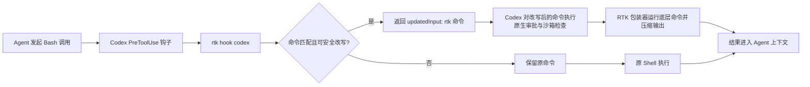
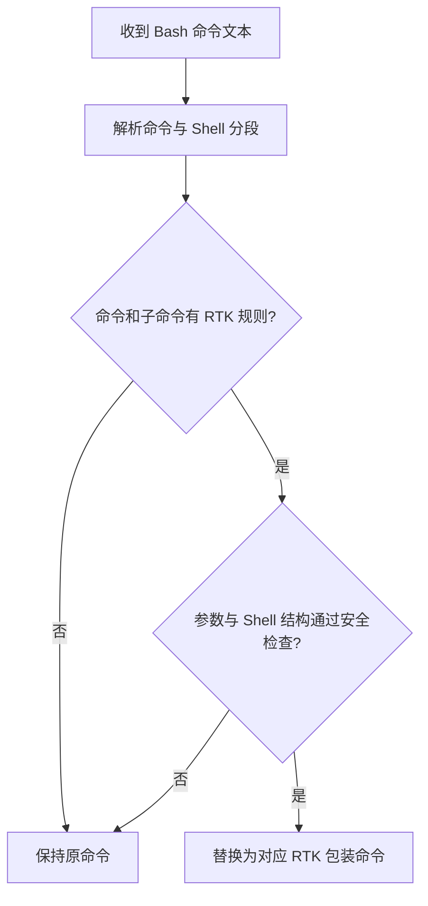
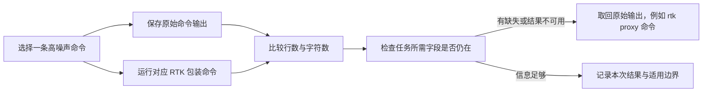

# RTK：压缩命令输出，降低 Agent 上下文噪声

本文以 RTK 0.51.0 和 Codex 的全局钩子集成为例，说明它如何压缩开发命令的输出、哪些命令会被改写，以及一次本机验证的结果和边界。

## 1. RTK 优化的是什么

RTK（Rust Token Killer）是一个 Rust 命令行代理。它为部分开发命令提供包装器和输出过滤器，把冗长结果压缩后交给 Agent。

它改变的是 **Bash 工具调用及其返回内容**，不改变模型权重、推理方法或答案生成能力。因此，它可能减少工具输出占用的上下文，但不能直接提升模型本身，也不等于总输入 Token 或费用按相同比例下降。

适合优先观察高噪声命令，例如 Git 历史和差异、测试日志、依赖清单、搜索结果及容器日志。应同时检查压缩结果保留了完成任务所需的信息。

## 2. Codex 中的工作流程

全局钩子把 Codex 的 Bash `PreToolUse` 事件交给 `rtk hook codex`。RTK 识别命令后，可以通过 `updatedInput` 把原命令替换成 RTK 包装命令；包装器运行底层程序并过滤输出。未匹配或被安全条件排除的命令沿用原始输入。



Codex 要求 `PreToolUse` 钩子返回 `permissionDecision: "allow"` 才会应用 `updatedInput`。这满足改写协议；Codex 仍会对改写后的命令执行自己的审批和沙箱检查。RTK 文档也提醒，Codex 的命令分类器未必能识别 `rtk` 包装后的原命令，某些安全命令可能多触发确认，而 `git push` 等写操作的风险信号可能不够明显。参见 [OpenAI Docs：Hooks](https://learn.chatgpt.com/docs/hooks) 和 [RTK Codex 钩子说明](https://github.com/rtk-ai/rtk/blob/v0.51.0/hooks/codex/README.md)。

## 3. “命中 RTK 规则”是什么意思

RTK 使用预设的命令规则和安全条件识别 Bash 输入。规则通常限定命令及其子命令；部分参数组合会跳过改写，以免改变原命令的输出语义。



本机用 RTK 0.51.0 的 `rtk rewrite` 检查了以下输入：

| Bash 输入 | 判定 | 改写结果 |
| --- | --- | --- |
| `git status --short` | 命中 Git 规则 | `rtk git status --short` |
| `cargo test -q` | 命中 Cargo 规则 | `rtk cargo test -q` |
| `python3 app.py` | 没有对应规则 | 原样执行 |
| `gh pr view 123 --json title` | 结构化 JSON 输出跳过改写 | 原样执行 |
| `sudo git status` | `sudo` 前缀跳过改写 | 原样执行 |

这些检查验证的是命令是否会被规则改写；命令不会因此执行。Codex 全局钩子还会检查事件类型和权限模式，并对命令替换、heredoc、文件目标重定向等无法安全分解的结构采用失败开放策略，即不改写原命令。

### 常见覆盖范围

以下是 RTK 0.51.0 文档中的代表性命令，具体参数、管道位置和配置排除项会影响是否改写：

| 类别 | 代表性命令 |
| --- | --- |
| Git 与代码托管 | `git`/`yadm` 的 status、log、diff、show、add、commit、push、pull；`gh` 的 PR、issue、run；`glab` 的 MR、CI、pipeline；Graphite `gt` |
| 文件与搜索 | `ls`、`find`、`cat`/`head`/`tail`、`grep`、`rg`、`ast-grep`、`diff`、`wc` |
| 构建、测试与依赖 | Cargo、npm、pnpm、npx、TypeScript、ESLint、Jest、Vitest、Next.js、Playwright、pytest、Ruff、mypy、Go、.NET、Maven、Gradle、Ruby 和 PHP 工具 |
| 基础设施与数据 | Docker、Kubernetes、OpenShift、AWS CLI、psql、curl |

RTK 的命令覆盖和典型输出变化见[官方命令覆盖说明](https://github.com/rtk-ai/rtk/blob/v0.51.0/docs/guide/resources/what-rtk-covers.md)，实际匹配规则见 [`rules.rs`](https://github.com/rtk-ai/rtk/blob/v0.51.0/src/discover/rules.rs)。覆盖范围会随版本变化。

## 4. 本机试用结果

在一个项目仓库中比较 `git log -n 10` 与 `rtk git log -n 10` 的输出：

| 方式 | 行数 | 字符数 |
| --- | ---: | ---: |
| 原始 `git log` | 59 | 1,950 |
| `rtk git log` | 10 | 908 |

这次样本减少约 83% 的行数和 53% 的字符数。RTK 结果保留了短哈希、作者、相对时间和提交主题；完整哈希和绝对日期没有保留。因此这是一次具体命令的输出对比，不是所有命令的固定收益，也不证明压缩结果对每个任务都足够。



`rtk gain --history` 对两次记录的 `rtk git log -n 10` 调用估算节省 56 个 Token（11%）。这是 RTK 的估算指标，基线和单位与上表的字符数对比不同，不应把两个百分比直接比较。

在 0.51.0 中，`rtk gain --history` 还显示了 “No hook installed” 警告。本机 Codex 配置检查显示钩子已注册，手动向 `rtk hook codex` 发送示例 `PreToolUse` 输入也得到正确的改写响应。源码中的通用告警检测读取的是 Claude 钩子配置，所以该提示不能单独用来判断 Codex 钩子状态；可用 `rtk init --global --codex --show` 查看 Codex 配置。参见 [`hook_check.rs`](https://github.com/rtk-ai/rtk/blob/v0.51.0/src/hooks/hook_check.rs)。

## 5. 全局安装与配置

本机验证环境安装了 RTK 0.51.0，二进制位于 PATH 中的 `~/.cargo/bin/rtk`。执行 `rtk init --global --codex` 后，RTK 在默认 Codex 用户目录注册了 `hooks.json`、写入 `RTK.md`，并在全局 `AGENTS.md` 中加入对该文件的引用。若设置了 `CODEX_HOME`，全局文件会使用该目录。

配置检查命令：

```bash
rtk --version
rtk init --global --codex --show
```

`hooks.json` 中的主要配置形态如下；手动添加时应合并到已有配置中：

```json
{
  "hooks": {
    "PreToolUse": [
      {
        "matcher": "Bash",
        "hooks": [
          { "type": "command", "command": "rtk hook codex" }
        ]
      }
    ]
  }
}
```

Codex 需要重启后加载新钩子。本次验证检查了配置注册和钩子处理器的响应，也直接运行了 RTK 包装命令；没有在当前会话重启应用后验证完整的自动触发链路。

## 6. 使用边界

- 钩子匹配器是 `Bash`。Codex 通过其他工具完成的文件读取、编辑和 MCP 调用，不属于这个 RTK Bash 规则集。
- 未支持的命令、被排除的参数形式及复杂 Shell 结构会保持原样；判断时可以先运行 `rtk rewrite '命令'`。有改写结果表示存在对应 RTK 命令，退出码为 1 且无输出表示没有可用改写。
- 输出过滤可能省略不常用字段。RTK 的全局说明建议把压缩结果视为当前命令的完整结果；只有在预期输出为空、结果与退出状态矛盾或内容不可用时，再用 `rtk proxy <cmd>` 取回未过滤结果。
- 对 `git push` 等会改变远端状态的命令，要留意 RTK 包装后 Codex 安全分类器可能显示不同的确认行为；核对目标、分支和命令参数，并保留 Codex 正常审批流程。
- RTK 能减少部分工具输出噪声；回答正确性、模型输出 Token 和整体任务成本仍需要分别评估。

## 7. 参考资料

- [RTK 项目与命令行说明](https://github.com/rtk-ai/rtk/tree/v0.51.0)
- [RTK Codex 钩子说明](https://github.com/rtk-ai/rtk/blob/v0.51.0/hooks/codex/README.md)
- [RTK 命令覆盖说明](https://github.com/rtk-ai/rtk/blob/v0.51.0/docs/guide/resources/what-rtk-covers.md)
- [RTK 命令改写规则](https://github.com/rtk-ai/rtk/blob/v0.51.0/src/discover/rules.rs)
- [RTK Codex 钩子处理器](https://github.com/rtk-ai/rtk/blob/v0.51.0/src/hooks/hook_cmd.rs)
- [OpenAI Docs：Hooks](https://learn.chatgpt.com/docs/hooks)
