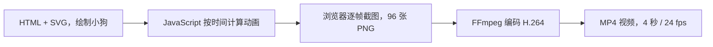

# 用 HTML/SVG 和 FFmpeg 生成视频：一次完整验证

**验证日期：** 2026-10-12

**目标：** 不使用 HyperFrames 或在线生成服务，直接用 HTML/SVG 绘制并动画化小狗，再把浏览器渲染的图像帧编码为 MP4。

## 流程概览

HTML 本身不是视频文件。HTML/SVG 描述画面和动画；浏览器按时间点把画面栅格化为 PNG；FFmpeg 读取 PNG 序列并编码视频。



可将职责理解为：

1. **HTML/SVG：** 画出背景、小狗身体、四肢、尾巴和装饰元素。
2. **JavaScript：** 提供 `renderAt(t)`，根据传入的时间 `t` 计算小狗的位置、身体起伏、腿部摆动、尾巴角度和速度线位置。
3. **浏览器：** 对每个时间点调用 `renderAt(t)`，将当前页面截成一张 PNG。
4. **FFmpeg：** 按帧率读取 PNG 序列，压缩并封装为 MP4；它不解析 HTML，也不负责绘制小狗。

## 本次实际操作

### 1. 用 SVG 画小狗并实现可重复的动画

在一个独立的 HTML 文件中内嵌 SVG 图形。小狗是由矢量路径、椭圆和简单背景组成的卡通图，没有调用图片或视频生成服务。

动画通过 `window.renderAt(t)` 暴露为按时间计算的渲染函数。捕获第 `i` 帧时传入 `t = i / 24`。同一个时间值总是得到相同的画面，不依赖 CSS 动画已经运行了多久，也不依赖截图之间的实际等待时间。

这种写法适合逐帧生成。若直接让 CSS 动画按墙上时钟运行，再逐张截图，截图耗时波动可能导致帧间时间不均匀或重复帧。

### 2. 启动本地 HTTP 服务

本次使用的 Playwright CLI 不允许直接打开 `file://` 页面，因此在 HTML 所在目录启动本地服务：

```bash
python3 -m http.server 8765 --bind 127.0.0.1
```

随后在浏览器中打开：

```text
http://127.0.0.1:8765/index.html
```

也可以将 `--directory` 指向 HTML 文件所在目录。服务仅绑定 `127.0.0.1`，供本机浏览器访问。

### 3. 按固定时间点捕获 PNG 帧

本次参数是 24 fps、4 秒，因此总帧数为：

```text
24 帧/秒 × 4 秒 = 96 帧
```

Playwright CLI 将页面设为 1280×720，逐次调用渲染函数并保存连续编号的帧。本次将下面的异步函数传给 Codex Playwright skill wrapper 的 `playwright_cli.sh run-code`：

```javascript
await page.setViewportSize({ width: 1280, height: 720 });

for (let i = 0; i < 96; i++) {
  await page.evaluate((t) => window.renderAt(t), i / 24);
  await page.screenshot({
    path: `frames/frame_${String(i).padStart(4, "0")}.png`,
  });
}
```

文件名从 `frame_0000.png` 到 `frame_0095.png`。截图序列是浏览器渲染和 FFmpeg 编码之间的中间结果。

### 4. 准备 FFmpeg 并编码 MP4

先准备中间帧、输出和本地运行包目录：

```bash
mkdir -p frames output runtime
```

如果系统已有 `ffmpeg`，可以直接把下面命令中的 `"$FFMPEG_BIN"` 替换为 `ffmpeg`。本次 Intel Mac 没有可直接使用的全局命令，Homebrew 下载依赖停滞，因此把 `imageio-ffmpeg` 安装到工作目录，并从包中取出 FFmpeg 可执行文件：

```bash
python3 -m pip install --target runtime "imageio-ffmpeg==0.6.0"
FFMPEG_BIN="$(PYTHONPATH=runtime python3 -c 'import imageio_ffmpeg; print(imageio_ffmpeg.get_ffmpeg_exe())')"
"$FFMPEG_BIN" -version
```

该运行包提供的二进制版本为 FFmpeg 7.1。安装在 `runtime/` 下，不修改系统 `PATH`。在包含 `frames/` 的工作目录中运行：

```bash
"$FFMPEG_BIN" -hide_banner -loglevel warning \
  -framerate 24 -start_number 0 \
  -i frames/frame_%04d.png \
  -frames:v 96 -an \
  -c:v libx264 -preset medium -crf 18 \
  -pix_fmt yuv420p -movflags +faststart \
  output/puppy.mp4
```

关键参数：

| 参数 | 用途 |
| --- | --- |
| `-framerate 24` | 指定输入图像序列按每秒 24 帧播放。 |
| `-start_number 0` | 从 `frame_0000.png` 开始读。 |
| `-i frames/frame_%04d.png` | 按四位数字序号读取 PNG。 |
| `-frames:v 96` | 限制输出为 96 帧，即 4 秒。 |
| `-an` | 不生成音轨。 |
| `-c:v libx264` | 使用 H.264 编码器。 |
| `-crf 18` | 设置 H.264 恒定质量参数；数值越低通常画质越高、文件越大。 |
| `-pix_fmt yuv420p` | 使用常见的视频像素格式，便于播放器兼容。 |
| `-movflags +faststart` | 将 MP4 索引移到文件前部，便于在线播放启动。 |

### 5. 检查生成文件

让 FFmpeg 读取视频并解码到空输出，可检查封装信息并确认帧能完整解码：

```bash
"$FFMPEG_BIN" -hide_banner -i output/puppy.mp4 -f null -
```

本次还用 `imageio_ffmpeg.count_frames_and_secs()` 统计帧数和时长，结果为 `96` 帧、`4.0` 秒。

## 验证结果

| 项目 | 结果 |
| --- | --- |
| 画面 | 草地背景上的卡通小狗奔跑 |
| 分辨率 | 1280×720 |
| 帧率 | 24 fps |
| 帧数 / 时长 | 96 帧 / 4 秒 |
| 编码 | H.264（`libx264`），`yuv420p` |
| MP4 文件大小 | 约 342 KB |
| 解码检查 | 96 帧完整解码，无报错 |
| 音频 | 无 |

本次编码用的是 `imageio-ffmpeg` 0.6.0 提供的 macOS Intel FFmpeg 7.1 二进制，运行包放在本地视频工作目录，没有安装到全局 `PATH`。Homebrew 在该机器上长时间停留于依赖下载，因此改用这个本地运行包完成编码。

## 踩坑和经验

- **直接用 `file://` 失败：** 当前 Playwright CLI 阻止 `file:` 页面，改用绑定到 `127.0.0.1` 的临时 HTTP 服务后正常。
- **SVG 旋转支点与 CSS 冲突：** 给 SVG 图层设置 CSS `transform-box` / `transform-origin` 后，SVG `rotate(angle, cx, cy)` 的坐标变换结果不符合预期，四肢会偏离画面。移除这组 CSS 覆盖后，让 SVG 的旋转变换直接使用明确的关节点坐标，四肢恢复正常。
- **FFmpeg 不会替 HTML 生成画面：** 它接收的是浏览器已经渲染好的 PNG 序列。若画面中有运动，必须先生成各个时间点的图像帧。
- **不同步骤耗时不同：** 这个案例中浏览器逐帧截图比 FFmpeg 编码更耗时；MP4 编码本身约 1 秒。复杂动画、高清分辨率和更高帧率都会增加截图数量和中间文件占用。
- **适用边界：** SVG 很适合这种图形简洁的卡通动画。写实角色通常需要先准备插画、照片或逐帧素材，再由 HTML/浏览器编排运动；逐点手绘复杂角色未必比 FFmpeg 绘图滤镜省事。

## 参考资料

- [FFmpeg 命令行文档](https://ffmpeg.org/ffmpeg.html)
- [FFmpeg Formats：image2 图像序列](https://ffmpeg.org/ffmpeg-formats.html#image2-1)
- [imageio-ffmpeg 项目说明与 FFmpeg 可执行文件发现逻辑](https://github.com/imageio/imageio-ffmpeg)
